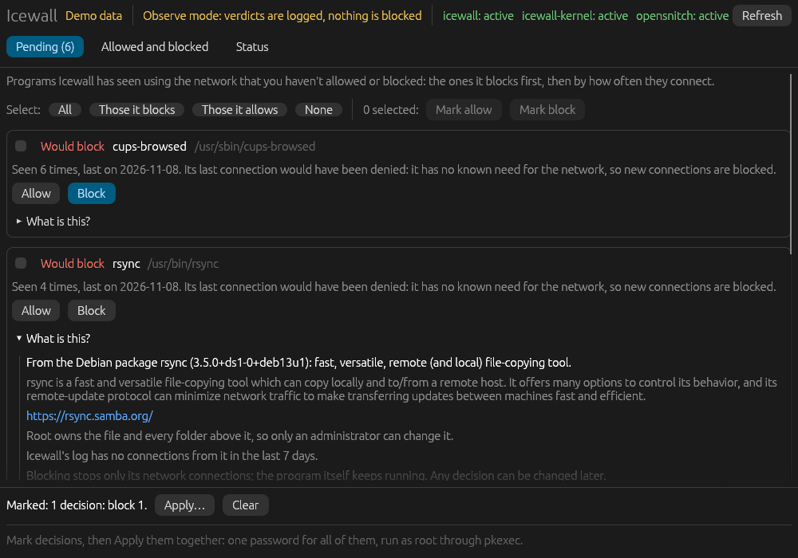
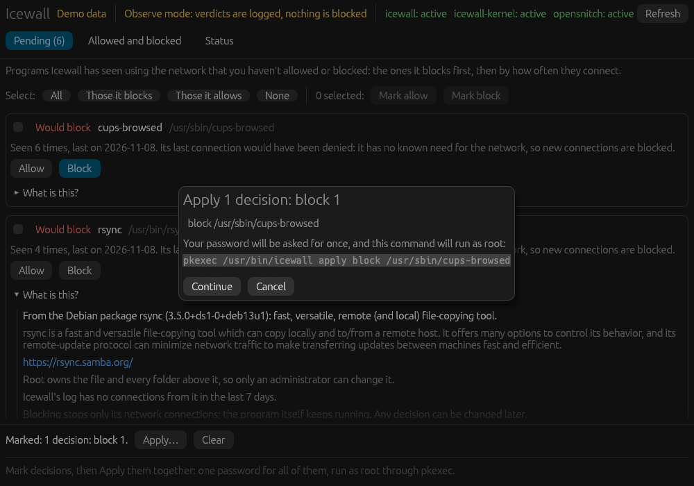
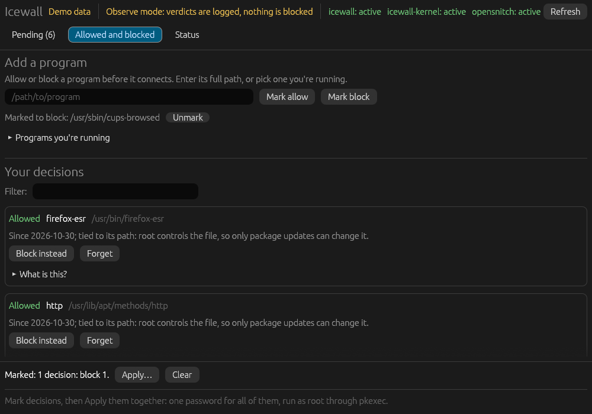
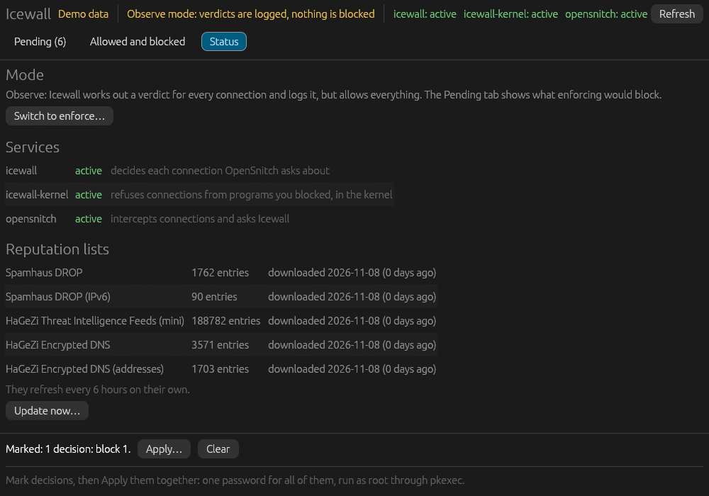
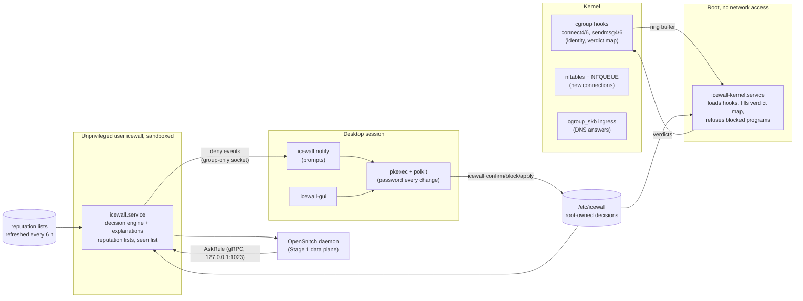

# Icewall

An application-aware egress firewall for Linux desktops. It decides which programs may connect out based on what each program is, and explains every verdict in plain language, citing its evidence.

This repository is the project's public technical overview. The source code is private for now.

| | |
|---|---|
| Language | Rust (2024 edition); eBPF programs in C (clang, CO-RE) |
| Platform | Debian 13, recent Linux with BTF (developed on 7.2), systemd, cgroup v2 |
| Size | ~9,100 lines of Rust, ~420 lines of BPF C, 161 automated tests |
| Packaging | Debian packages `icewall` and `icewall-gui` (lintian clean) |
| Status | Stage 1 in daily use; Stage 2 (own eBPF data plane) partly built, verified live |
| Recorded design decisions | 50, each with its reasoning |

---

## Contents

1. [Problem and approach](#1-problem-and-approach)
2. [Desktop app](#2-desktop-app)
3. [Architecture](#3-architecture)
4. [Completion status](#4-completion-status)
5. [Security model](#5-security-model)
6. [Engineering log: defects found and fixed](#6-engineering-log-defects-found-and-fixed)
7. [Key design decisions](#7-key-design-decisions)
8. [Verification methods](#8-verification-methods)
9. [Known limits](#9-known-limits)
10. [Roadmap](#10-roadmap)

---

## 1. Problem and approach

**Problem**
- Desktop firewalls get switched off because their prompts can't be answered. `allow firefox -> 34.120.1.1:443?` means nothing to most people, so they click "allow always" or uninstall.
- Port and address firewalls can't tell programs apart. A compromised desktop shows itself on the way out: an unexpected program making an unexpected connection.

**Approach**
- **Egress only, metadata only.** Nearly all traffic is TLS, so Icewall reasons over who connects, where, how often and to what reputation. It never inspects payloads or terminates TLS.
- **Deny by default, tiered by program class.**
  - Quiet programs (no known need for the network): strict. Any connection is a strong signal.
  - Chatty-bounded programs (updaters, sync clients): their usual hosts are allowed.
  - Chatty-open programs (browsers, interpreters, developer tools): reputation and anomaly checks only, never blocked for novelty alone.
- **Trust comes from ground truth, never from occurrence.** A program becomes trusted only when something independent vouches for it: the user's confirmation, root ownership of its file, a clean reputation. Watching traffic for a while and trusting what was seen would teach the firewall to trust malware already on the machine.
- **Evidence-bound explanations.** Each verdict is a templated sentence built only from collected facts, naming its source and how fresh it is ("Spamhaus DROP, downloaded today"). When the evidence is missing, it says "can't tell". A language model is optional polish and is never in the decision path.

**Example explanation** (enforce mode; output of the explanation code for a test case, with documentation addresses)

```text
gedit (/usr/bin/gedit) is making a connection to analytics.example (203.0.113.9, tcp port 443).
Icewall has no record of this program needing the network, and it blocks what it can't confirm,
so it was blocked. If you recognise it, allow it with: sudo icewall confirm '/usr/bin/gedit'
```

In observe mode the same sentence ends "so it would be blocked (observe mode: it was allowed)".

---

## 2. Desktop app

`icewall-gui`, built with egui. These screenshots use the app's demo mode, which loads made-up programs and history and never runs changes; no data from a real machine appears.

**Pending:** programs without a decision, the ones Icewall would block first. "What is this?" shows the owning Debian package, its description, who controls the file, and recent activity.



**Confirmation:** decisions are marked, then applied together. The dialog shows the exact command that will run as root; the system password prompt follows (polkit, asked again for every change).



**Allowed and blocked:** the user's decisions, how each is tied to its program (by path, or by file contents when the location isn't root-controlled), and adding a program before it connects.



**Status:** mode, services, and reputation lists with entry counts and download dates.



---

## 3. Architecture



**Processes and privileges**

| Process | Runs as | Privileges | Inputs |
|---|---|---|---|
| `icewall.service` (decision engine) | user `icewall` | `CAP_NET_BIND_SERVICE`, `CAP_SYS_PTRACE` only; strict systemd sandbox (`systemd-analyze security`: 2.1) | OpenSnitch requests on loopback, root-owned decisions, reputation lists |
| `icewall-kernel.service` (eBPF agent) | root | `CAP_BPF`, `CAP_NET_ADMIN`, `CAP_PERFMON`, `CAP_SYS_PTRACE`, `CAP_DAC_READ_SEARCH`; `IPAddressDeny=any` | kernel events and the decision store only |
| `icewall-feeds.service` (every 6 h) | root, with an empty capability set | sandboxed (`systemd-analyze security`: 2.0); writes only the lists directory | list URLs |
| `icewall notify`, `icewall-gui` | the desktop user | none; changes go through `pkexec` | events socket (group `icewall`), installed files |

**Data handled, and not handled**
- Recorded: program paths, connection counts, first and last seen times, verdict and reason.
- Never recorded: destinations (a destination list would be a browsing history), process environments (they often hold secrets; dropped as they arrive), payloads.
- Deny events reach the desktop over a group-only socket and are never written to disk.

**Program identity (Stage 2)**
- Key: device, inode number and inode generation, read in the kernel from the running task's executable. So a process that exits immediately is still attributed, and a reused inode number counts as a new file.
- The file's ctime is read alongside, so rewriting a binary in place (same inode) is noticed.
- Decisions are tied to a path only when root controls the file and every directory above it; otherwise to the SHA-256 of the running image.

---

## 4. Completion status

| Stage | Scope | State | Verified by |
|---|---|---|---|
| 1 | Decision engine behind OpenSnitch: tiers, explanations, reputation lists, confirmations, overrides, desktop prompts, observe/enforce modes | **Built, installed, in daily use** | live traffic; 161 tests; installed under systemd sandbox |
| 2a | Own eBPF hooks (connect/sendmsg), shadow trace | **Built** | live trace on ext4 and btrfs |
| 2b | Identity in pinned maps; deny-only enforcement in the kernel | **Built, installed** (observe mode) | inode generation vs `lsattr`; ctime vs `stat`; verdict map through touch and rewrite; enforcement refused a blocked program (`curl` exit 7) |
| 2c | NFQUEUE slow path, own DNS view, socket-bound identity | **Shadow mode built**; holding packets designed, not built | 3,867 of 3,869 desktop flows matched to one program; shadow verdicts agreed with Stage 1 on 27 of 27; staged UDP spoof caught |
| 2d | Volume, timing, SNI, JA3/JA4 sensors | Planned | — |
| 3 | Native integration into a custom OS kernel (separate project) | Planned | — |
| GUI | Desktop app for non-experts | **Built, packaged** | used live; demo mode for screenshots |
| Packaging | Debian packages, install/remove/purge | **Built, installed** | lintian clean; swap from source install verified |

**Next step in progress:** the root agent passes the queue socket and BPF map descriptors to the unprivileged service, so packet parsing stays out of the root process before any packet is held.

---

## 5. Security model

**In scope**
- Programs running as the user that phone home: trojaned binaries, malicious dependencies, tools with no business on the network.
- Impostors: a binary named `firefox` outside system directories gets no browser leniency (name hints count only under root-owned system paths).
- Replaced binaries: content-bound decisions stop applying when the file changes; path-bound ones require root to change the file.
- Tampering by code running as the user: decisions live in a root-owned store; every change needs the administrator password, every time (`auth_admin`, no caching), and the dialog shows the real command.
- Impersonating the decision engine: it listens on privileged port 1023, which an unprivileged process can't take while the engine is down.

**Explicitly out of scope / limited**
- Code running *inside* a trusted browser or interpreter inherits its latitude. Icewall still catches known-bad destinations, but can't see inside (see [Known limits](#9-known-limits)).
- Root compromise. The design is tamper-evident and user-sovereign: every disable and edit is loud, logged and re-authenticated. It isn't tamper-proof against root.

**Hardening**
- Rust throughout userspace; BPF programs checked by the kernel verifier.
- Decision engine sandbox: `ProtectSystem=strict`, `ProtectHome=read-only`, `NoNewPrivileges`, `MemoryDenyWriteExecute`, `SystemCallFilter=@system-service`, loopback-only IP access, two capabilities.
- Root agent: no network (`IPAddressDeny=any`), a fixed capability set, a system call filter limited to `@system-service` plus `bpf`.
- Reputation lists installed only if they meet minimum entry counts with under 10% rejected lines; private and reserved addresses are never treated as listed.
- Fail-safe modes: observe by default. When enforcing, OpenSnitch's default action is kept at deny, so connections Icewall isn't asked about are refused, never let through.

---

## 6. Engineering log: defects found and fixed

Defects found during live testing, with cause, fix and how the fix was confirmed.

| # | Symptom | Cause | Fix | Confirmed by |
|---|---|---|---|---|
| 1 | Every request from OpenSnitch was reset (`RST_STREAM PROTOCOL_ERROR`) | OpenSnitch's gRPC client sends the Unix socket path as the HTTP/2 `:authority`; Rust's `h2` rejects it | Loopback TCP on privileged port 1023 (closes the impersonation gap TCP would open); upstream fix identified | probe script reproducing each authority form |
| 2 | Observe mode said "was blocked" for allowed connections | wording didn't account for the mode | "would be blocked (observe mode: it was allowed)" | test |
| 3 | A DNS query read as a connection to the looked-up site at the resolver's address | DNS treated like any connection | "a DNS lookup of X through the server at Y" | test |
| 4 | A program that sends one packet and exits was never seen | without its eBPF module OpenSnitch identifies programs from `/proc` after the fact; unidentified traffic passed unasked | installer adds the module and sets unidentified traffic to be asked about; Icewall denies unidentified sources | one-packet-and-exit program now identified |
| 5 | Simultaneous connections bypassed the decision engine | OpenSnitch asks about one connection at a time; others get its default action | the mode switch sets that default to deny when enforcing; mismatch warned at every start | 0 of 5 concurrent connections got through |
| 6 | A desktop prompt stayed on screen with a stale Allow button | notification marked "resident" | non-resident decision prompts | test; live |
| 7 | The same file had different device numbers in the kernel and in `stat` on btrfs | btrfs subvolumes report their own device; the kernel uses the superblock's | map keys taken verbatim from kernel events | live, ext4 and btrfs |
| 8 | A deleted program's verdict could apply to a new file reusing its inode | inode numbers are recycled | inode generation in the key; ctime canary for in-place rewrites | matches `lsattr -v` and `stat` live |
| 9 | A program rewriting its own file could force endless rehashing, and one slow hash held up all others (found in design review) | no rate limit; one global lock across all hashing | per-file lock, torn hashes discarded, quarantine after 3 versions a minute | tests |
| 10 | Kernel verifier rejected the DNS copy program ("invalid zero-sized read") | the compiler removed a length check it could prove, leaving a path the verifier couldn't | length computed by masking | loads on the target kernel |
| 11 | Planned design for socket identity couldn't work | the egress hook runs after netfilter's output hook, so identity would arrive after the verdict | socket cookies recorded at connect time; queued packets looked up by exact 5-tuple via `sock_diag` | live |
| 12 | `sock_diag` lookups for UDP returned "not found" | the kernel's UDP lookup reads the request's addresses the other way round; reply offset off | swap for UDP; correct cookie offset | unit test against real sockets |
| 13 | Later packets of a UDP flow (QUIC, paired DNS queries) went unmatched | conntrack keeps a UDP flow "new" until its first reply | flows tracked by source port | 9 of 9 scripted flows, HTTP/3 included |
| 14 | TCP retransmits after 30 s went unmatched | flow memory shorter than conntrack's 120 s SYN_SENT timeout | flow memory raised to 120 s | 5-minute desktop run |
| 15 | A DNS query was matched to a program that connected after it was sent | matching ignored order | kernel timestamps on hook calls; only earlier calls match | live |
| 16 | **Security:** time-based matching could be spoofed for UDP by a same-user program | it paired packets with calls by destination and time | socket-bound identity required before any packet is held | staged spoof fooled the old matcher, not the new one |
| 17 | Shadow comparison reported false disagreements | OpenSnitch answers once for identical simultaneous connections; local multicast isn't logged | twins within 1 s share one answer; local traffic excluded | 27 of 27 agreed |
| 18 | Novices were asked for the password once per decision | each change ran separately | decisions marked, then applied in one batch under one password | live |
| 19 | App dates were a day ahead in the evening | dates formatted in UTC | local dates in the app (logs stay UTC) | screenshots above |

---

## 7. Key design decisions

A selection from the 50 recorded decisions.

| Decision | Why |
|---|---|
| Deny by default, tiered by program class | blocking browsers and interpreters on novelty breaks apps and gets the firewall switched off; quiet programs are where malware hides |
| Trust graduates only on ground truth (user, root ownership, reputation), never on occurrence | learning from observed traffic bakes existing malware into the allowlist |
| Deterministic code decides; any language model only phrases, off the critical path | latency, privacy, and a model failure must never drop or allow traffic |
| Explanations are templates over collected facts, citing source and date | a confident wrong explanation is worse than none |
| Stage 1 on OpenSnitch's data plane, then own eBPF, then native kernel | test the new part (decisions and explanations) before building packet plumbing |
| Rust, libbpf-rs with BPF in C | memory safety for a security daemon; the Rust-native BPF toolchain needed a compiler version the target distro doesn't ship |
| Never store destinations or process environments | a destination list is a browsing history; environments hold secrets |
| Decision engine unprivileged; kernel agent root but offline and fed only kernel events and the decision store | keep network-facing parsing out of the root process |
| Every change needs the password, every time, with the exact command shown | the password dialog is the trust anchor; code running as the user can't ride on a recent approval |
| Overrides of a reputation listing cover one program and one exact destination, expire, and have no one-click button | "allow anyway" on a threat warning is how people get infected |
| No packet is held on time-based attribution | a same-user program could spoof it (defect 16) |
| While OpenSnitch is still in place, Icewall failures fall back to it; after cutover, fail closed when enforcing | nothing is lost during the transition; afterwards a crash must not switch the firewall off |
| Debian package leaves OpenSnitch's config to an explicit setup command, and undoes it on removal | packages must not edit another package's config; a dangling connection would deny everything |

---

## 8. Verification methods

- **Automated tests:** 161 (unit and integration), including a gRPC round trip against the real protocol, the trust store, list parsing and installation rules, and `sock_diag` lookups against real sockets.
- **Live tests on the development machine** for every kernel-facing feature, recorded with numbers: flows matched, verdicts agreeing, attempts blocked.
- **Shadow before enforcing:** every Stage 2 component first runs beside the working Stage 1 and its answers are compared, before anything depends on it.
- **Staged attacks:** an impostor binary, a one-packet-and-exit program, concurrent connections, and a UDP spoof against the matcher.
- **Install checks:** live capabilities of the running service, `systemd-analyze security` scores, lintian on the packages.

---

## 9. Known limits

- **Trusted programs carry their latitude.** Code injected into a browser or interpreter acts as that program; Icewall still catches known-bad destinations and anomalies against the program's own history. Pair it with app sandboxing.
- **Names are disappearing from the wire.** Encrypted DNS and Encrypted Client Hello hide hostnames. Icewall falls back step by step (DNS seen locally, then certificate, address owner, bare address), says which it used, and treats a program doing its own encrypted DNS as a fact worth reporting.
- **Stage 1 inherits OpenSnitch's single-question limit.** Mitigated by deny as the default action when enforcing; removed by design in Stage 2.
- **Thresholds can be evaded.** Low-and-slow traffic can stay under volume and timing thresholds; comparing against each program's own history raises the bar but isn't airtight.
- **Not tamper-proof against root.** Tamper-evident instead (see [Security model](#5-security-model)).

---

## 10. Roadmap

1. Pass the queue socket and maps from the root agent to the unprivileged service (in progress).
2. Hold unknown connections in the slow path, beside OpenSnitch, then cut over and retire OpenSnitch.
3. Allow confirmed programs in the kernel once destination checks are there too.
4. Sensors for volume, timing, SNI and TLS fingerprints (Stage 2d).
5. Desktop: tray icon, prompts folded into the app, follow the system colour scheme.

---

*Screenshots: `icewall-gui --demo`, with data from the project's demo generator. All program names under `/opt/example-*` and all history are invented.*
